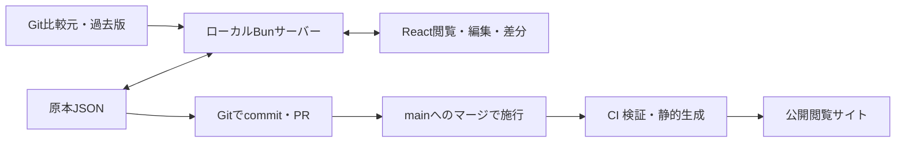

**規則・決定原本とWebツールの設計**

2026年11月9日の会話で確定した要件に基づく実装仕様。以前のREADMEは仕様の根拠にしない。

**責務**

リポジトリはスキーマ付きJSON原本とGit履歴を管理する。Webアプリは閲覧・新規作成・編集・差分・履歴表示を補助する。編集者がクローンしてPRを作成し、mainへのマージで施行する。申請・議論・承認やGitHubへの書き込みは行わない。議決日・機関・理由のフィールドは持たない。

**データ**

- 現行形式は`schema/document.schema.json`。文書IDとファイル名は一致させる。
- 条番号は「第一条」「第六条の二」等の名称として保存する。順序変更で番号を書き換えない。
- 文書・章・条・項・号・附則をUUIDで追跡する。手書きJSONのUUID欠如はコミット前に補完する。UIは編集中の差分のため先にUUIDを確保する。
- 全項を同じデータ構造とする。表示では第1項番号を省略し、条名に続けて本文を置く。第2項以降に項番号を表示する。
- 決定・公示等は条文構造のほか、単一の本文文字列を受け付ける。規則は条文構造とする。
- 章・条・項・号の階層を維持し、附則本文を扱う。編・節・款、添付ファイル・別表は初期対象外。
- 原本本文はプレーンテキストとし、空白・改行・Unicodeを勝手に変換しない。
- 制定・改正の業務記録は追加しない。過去版はGitコミットから読み取る。

旧会則は26条の本文、項・号、章順、固定リンクを保持して移行した。旧スラッグは`anchor`、新しい追跡IDは`uuid`として役割を分ける。旧形式を過去版として表示する際も、同じ旧IDから同じUUIDを導出する。旧形式の日付だけの記録はGitに残し、現行原本には保存しない。

**実装構成**

Bun＋React〈TSX〉＋Tailwind CSSで単一アプリを構成する。React RouterはDeclarative Modeで用いる。Bunの配信・ファイル・ビルド・プロセス・テストAPIを使い、未対応のファイル操作にはBun上の`node:fs/promises`等を用いる。

`src/domain`に編集・差分・検証・参照・保存形式を置く。`src/server`は原本保存とGitアクセスを担当し、`src/web`の共有描画をローカルと公開サイトで使う。旧形式移行はBunで動かすサーバー側の処理とする。

JSON Schema検証にはAjv、型生成にはjson-schema-to-typescript、文字差分にはdiffを使う。編集状態はReactで管理し、DB・ORM・外部認証・大規模な状態管理ライブラリは追加しない。

**閲覧と編集**

e-Govの実画面で履歴・目次・本文の独立スクロール、目次ジャンプ、表示切り替え、条文比較を確認した。左に変更履歴と目次、右に本文を置き、文書名と下部操作欄を固定する。目次の目のボタンと全表示・全非表示で本文を切り替える。文書内検索では一致箇所を強調し、次の一致箇所へ移動する。

白地・黒文字を基本とし、青はリンクと選択状態、黄色は差分と検索一致、赤はエラーに用いる。装飾的なカード、影、大きな余白、固定の説明コピーは置かない。

編集時は左に比較元・目次、中央に本文、右に差分・検証結果を置く。本文の組版を共有し、入力中の条・項に構造操作を表示する。新旧対照表は変更後を左、変更前を右に置き、変更のない条文も文脈として残して条・項を行ごとに揃える。変更箇所への移動と、変更箇所のみの表示にも対応する。狭い画面では目次を開閉し、本文と差分を切り替える。日本語IMEはブラウザの入力欄で扱い、変換中の保存ショートカットは無視する。

章・条・項・号・附則の作成・削除、並べ替え、章をまたぐ条の移動、Undo/Redo、明示保存に対応する。条名の再採番も明示操作とする。本文中の参照を自動置換しない。

**差分と履歴**

Git上の比較元、保存済み作業ツリー、編集中の状態を分ける。通常差分は比較元から編集中への差であり、保存しても消えない。未保存の表示は保存済みと編集中を比べる。

比較元はローカルmainとのmerge-baseを既定とし、取得済みorigin/main、HEADの順に代替する。自動fetchは行わない。HEADへ切替可能とし、実際に解決したSHAを表示する。比較元更新は明示操作とする。

UUIDによる対応付けと共通要素の順序比較を使い、途中挿入で既存要素全部を移動と誤認しない。名称変更・本文変更・移動は区別する。文字差分は計算量を制限し、大幅な全文変更では全文の追加・削除へ切り替える。

Git履歴から各版の本文と現在の本文との差を表示する。公開時はGitから読み出した過去版JSONを静的成果物へ出力する。原本ファイルの改名追跡、意味からの条文参照解決、共同編集は初期対象外。

**保存とコミット**

ローカルAPIはループバックに限定し、Host・Origin・編集用トークンを検査する。任意パス・Gitコマンドは受け付けない。シンボリックリンクは拒否する。Gitへは解決済みSHAと限定したパスを引数配列で渡す。

保存ではスキーマ・UUID重複・名称重複等を検証し、内容ハッシュで外部更新を確認する。同一文書のサーバー内保存を直列化し、同一ディレクトリの一時ファイルから置換する。新規文書は排他的に作成する。別プロセスとの厳密な同時書き込み協調は対象外。

保存形式はUTF-8・LF・2スペース・固定キー順・末尾改行。未知フィールドは削除せず、検証で保存を拒否する。

コミット前処理はステージ済み原本のUUIDを補完・検証する。UUID未付与かつ部分ステージの場合は停止する。`bun run commit`でフックを有効にでき、通常のGitでも使う場合はクローンごとに`bun run hooks:install`を実行する。CIはUUID未付与・重複を拒否する。

**公開と検証**

GitHub Pagesを想定し、既定base pathは`/law/`。Reactから文書ごとに静的HTMLを生成し、直接アクセスで本文を読めるようにする。公開エントリから編集モジュールを参照しない。公開側に保存API・編集トークンを置かない。旧編集URLはローカル編集の案内を表示する。

PRとmainで同じ原本検証・型チェック・テスト・ビルド・ブラウザテストを行う。履歴表示のため、CIはGit履歴を省略せず取得する。mainへのpushで公開する。デプロイ中は以前の版を表示するため、公開物にコミットSHAを表示する。

テストは、途中挿入・移動・再採番の差分、第1項番号の省略、旧版の変換、UUID補完、部分ステージ保護、保存競合、不正な保存・パス・Originの拒否、実ブラウザでの編集・保存・履歴・モバイル表示を対象とする。

**参照資料**

- [参議院法制局：条・項・号・号の細分](https://houseikyoku.sangiin.go.jp/column/column021.htm)
- [e-Gov：参照された民法のページ](https://laws.e-gov.go.jp/law/129AC0000000089#Mp-Pa_3-Ch_2-Se_1-Ss_1)。目次と本文を中心とする画面構成の参考。
- [Bun：Fullstack dev server](https://bun.com/docs/bundler/fullstack)
- [Bun：File I/O](https://bun.sh/docs/runtime/file-io)
- [React Router：Picking a Mode](https://reactrouter.com/start/modes)
- [jsdiff公式リポジトリ](https://github.com/kpdecker/jsdiff)
